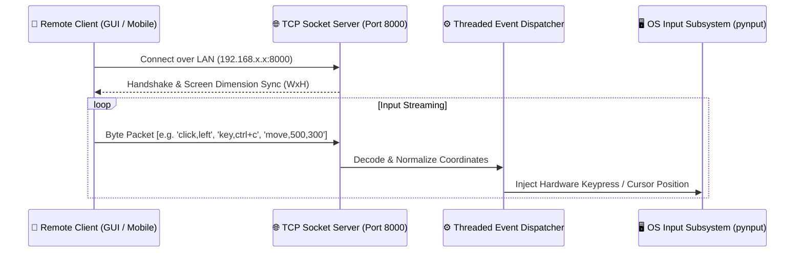

# ⌨️ Remote_Keyboard — Low-Latency TCP Socket Input Bridge

[](https://www.python.org/)
[](https://docs.python.org/3/library/socket.html)
[](https://pynput.readthedocs.io/)
[](https://github.com/rr-/screeninfo)
[](LICENSE)

A high-speed, lightweight TCP socket bridge for remote hardware input injection. It enables controlling a host machine's mouse and keyboard seamlessly across local networks with sub-millisecond packet latency, multi-monitor coordinate scaling, and full keycode translation.

---

## 🔄 Network & Input Architecture



---

## ⚡ Key Capabilities

- **🚀 Sub-Millisecond Input Latency:** Direct raw TCP socket streaming without heavyweight HTTP/WebSocket wrappers.
- **🖱️ Multi-Monitor Resolution Scaling:** Integrates with `screeninfo` to map relative touch coordinates to absolute pixel boundaries across multiple displays.
- **⌨️ Comprehensive Keycode Mapping:** Full support for standard alphanumeric keystrokes, modifier combinations (Ctrl, Shift, Alt, Cmd), and special function keys.
- **🧵 Thread-Safe Connection Pooling:** Multi-threaded server daemon handles disconnections, reconnects, and concurrent event packets gracefully.

---

## 📂 File Structure

```
Remote_Keyboard/
├── remote_server.py      # Multithreaded TCP server receiving packets & injecting inputs
├── remote_keyboard.py    # Client interface / packet generator
└── README.md             # Technical documentation
```

---

## 🚀 Getting Started

### Installation

```bash
# 1. Clone repository
git clone https://github.com/abhay2008/Remote_Keyboard.git
cd Remote_Keyboard

# 2. Install dependencies
pip install pynput screeninfo
```

### Running the Server (Host Machine to be Controlled)

```bash
# Start host listener daemon
python remote_server.py
```

### Running the Client (Controller Device)

```bash
# Connect and stream input events
python remote_keyboard.py
```

---

## 👨‍💻 Author

**Abhay Kashyap**
- GitHub: [@abhay2008](https://github.com/abhay2008)
